<div align="center">

# Mitch CRM

**業務親訪的好幫手**

排路線、到訪打卡、現場照片自帶浮水印存證。該拍的沒拍齊,案子結不了。

[](CHANGELOG.md)
[](LICENSE)
[](https://github.com/chenmitchell)
[](#)

[](apps/frontend)
[](apps/backend)
[](apps/backend/prisma/schema.prisma)
[](package.json)
[](#怎麼開始)
[](SECURITY.md)

</div>

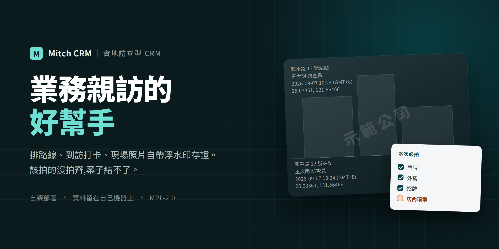

---

## 目錄

- [這是在解決什麼問題](#這是在解決什麼問題)
- [用之前跟用之後](#用之前跟用之後)
- [這是給誰用的](#這是給誰用的)
- [一趟拜訪長什麼樣](#一趟拜訪長什麼樣)
- [成交守衛](#成交守衛)
- [照片存證怎麼運作](#照片存證怎麼運作)
- [沒有訊號的時候](#沒有訊號的時候)
- [誰看得到誰的資料](#誰看得到誰的資料)
- [後台控制前台](#後台控制前台)
- [功能總表](#功能總表)
- [角色與權限](#角色與權限)
- [後台可以設定的項目](#後台可以設定的項目)
- [螢幕截圖](#螢幕截圖)
- [怎麼開始](#怎麼開始)
- [環境變數](#環境變數)
- [目錄結構](#目錄結構)
- [常見問題](#常見問題)
- [文件](#文件)
- [貢獻](#貢獻)
- [授權](#授權)

---

## 這是在解決什麼問題

管客戶名單的工具滿街都是,這一套的重點在後半段:**人到底有沒有到現場,以及事後拿不拿得出證據。**

- 業務說去過了,但拿不出東西。照片可能是上個月拍的,也可能是別人給的。
- 主管不知道今天誰跑了哪裡。要問,要等回報,回報的品質看人。
- 案子結了才發現該拍的沒拍。人已經離開現場,補不回來。

做法是把證據綁在流程上:

> 到訪時打卡,記下座標、定位精度、與登記地址的距離。當場拍照,浮水印在裝置端就壓好,伺服器收到的就是已經壓過的那一張。每一種場所該拍哪幾張由後台定,沒拍齊,標記成交的按鈕按不下去。

## 用之前跟用之後

| | 用之前 | 用之後 |
|---|---|---|
| 現場證據 | 手機相簿裡一堆分不清時間地點的照片 | 每張照片自帶對象、拍攝人、時間、經緯度,壓在畫素上 |
| 有沒有到現場 | 靠回報 | 打卡記錄座標與定位精度,自動比對登記地址的距離,可疑的標出來 |
| 該拍的有沒有拍齊 | 結案後才發現漏了 | 缺件時成交按鈕直接擋住,並列出還缺哪幾張 |
| 主管看得到什麼 | 等日報,等會議 | 戰情圖表、拜訪地圖、日報彙整,當天就看得到 |

## 這是給誰用的

- 需要派人到現場、而且事後要拿得出證據的組織
- 業務拜訪、設備維修派工、物件巡查、環境稽核、社福訪視、委辦案件查核
- 想把資料留在自己機器上的團隊
- 有分層的團隊:業務只看自己的,主管看團隊的,管理員看全部

---

## 一趟拜訪長什麼樣

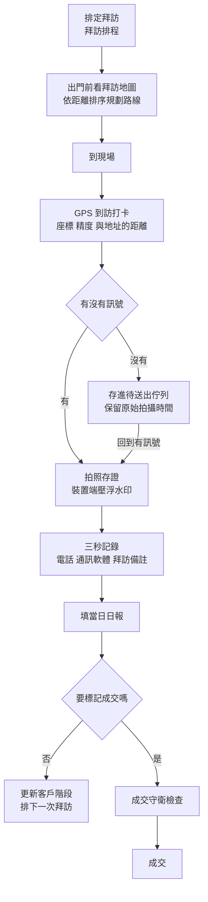

**純文字版:** 排定拜訪之後,出門前先看拜訪地圖依距離排路線。到現場打卡,系統記下座標、定位精度、與登記地址的距離。有訊號就直接拍照上傳,沒訊號就存進裝置的待送出佇列,保留原始拍攝時間,回到有訊號的地方一鍵重送。拍完做三秒記錄,當天填日報。要標記成交前會先跑一次成交守衛,通過才成交;不成交就更新階段並排下一次拜訪。

## 成交守衛

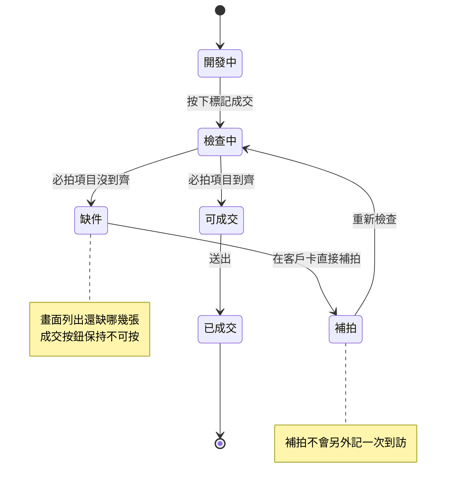

**純文字版:** 客戶在開發中的任何一階,按下標記成交會先跑檢查。必拍項目沒到齊就進入缺件狀態,畫面列出還缺哪幾張,成交按鈕維持不可按並說明原因;可以在客戶卡上直接補拍,補拍走的是不記到訪的路徑,重新檢查通過後才送得出去。必拍項目由後台的照片存證檢查表定,依場所類型決定該拍哪幾張。

## 照片存證怎麼運作

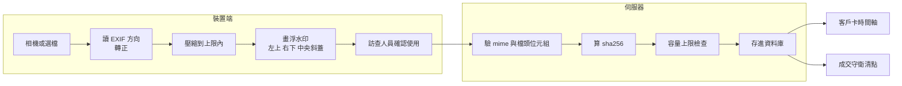

**純文字版:** 拍照或選檔之後,裝置端先讀 EXIF 方向把直拍的照片轉正,壓縮到單張上限之內,再畫上浮水印:左上與右下各一份文字塊,中央一行斜蓋的組織名稱。訪查人員按下確認使用才會送出,所以上傳的位元組本身就已經帶著浮水印。伺服器端驗 MIME 與檔頭位元組、算 sha256、過容量上限,才寫進資料庫。存好的照片同時出現在客戶卡的時間軸,並被成交守衛清點。

## 沒有訊號的時候

外勤現場常常沒有訊號:地下室機房、鐵皮廠房、山區站台。

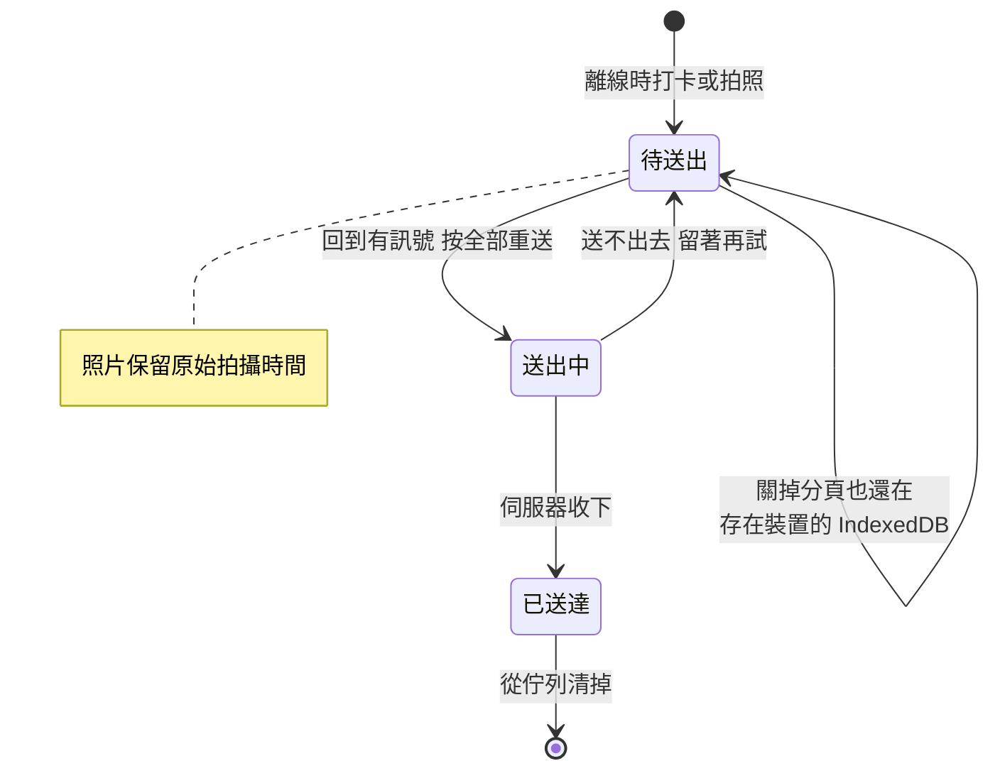

**純文字版:** 離線時打卡與已拍的照片會寫進裝置的 IndexedDB 待送出佇列,關掉分頁也不會消失,而且保留照片原始的拍攝時間。回到有訊號的地方按一次全部重送,送成功才從佇列清掉。離線時每一頁最上面都有提示,打卡、拍照、日報三條路徑的訊息會明講現在可以做什麼。

## 誰看得到誰的資料

授權在後端做,所有查詢共用同一份可見範圍的計算。

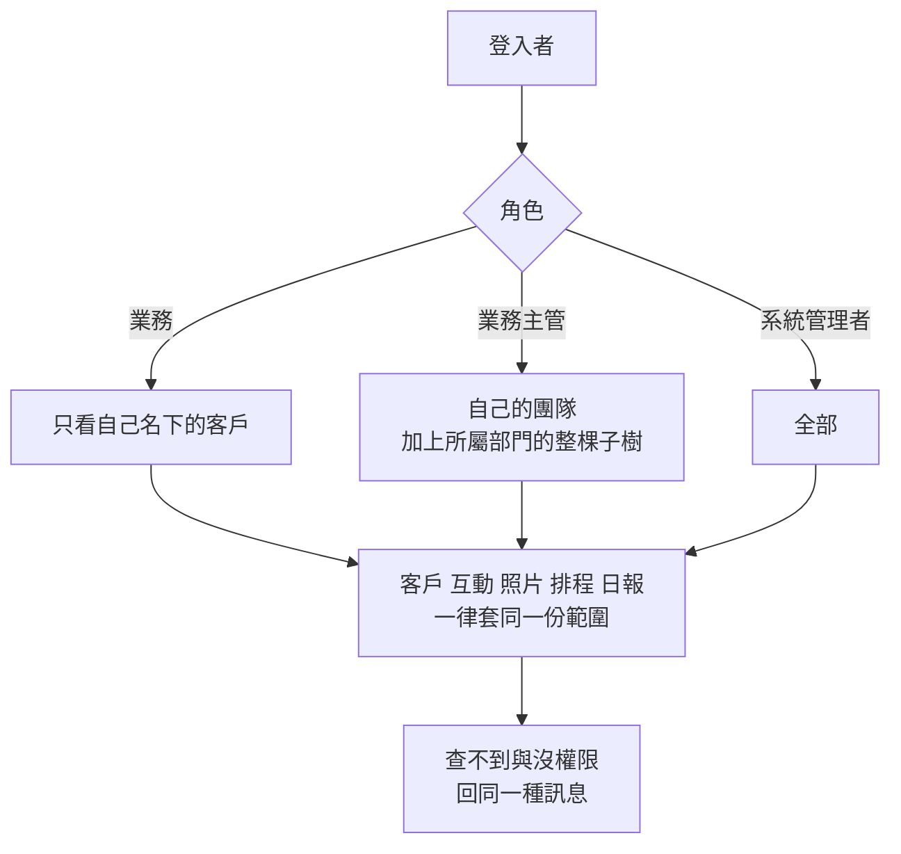

**純文字版:** 業務只看得到自己名下的客戶;業務主管看得到自己團隊的成員,加上所屬部門往下整棵子樹的成員;系統管理者看得到全部。這份範圍集中在同一個地方算好,客戶、互動紀錄、照片、拜訪排程、日報全部套用同一份。查不到資料與沒有權限回的是同一種訊息。

## 後台控制前台

**前台不出現寫死的業務用語清單。**

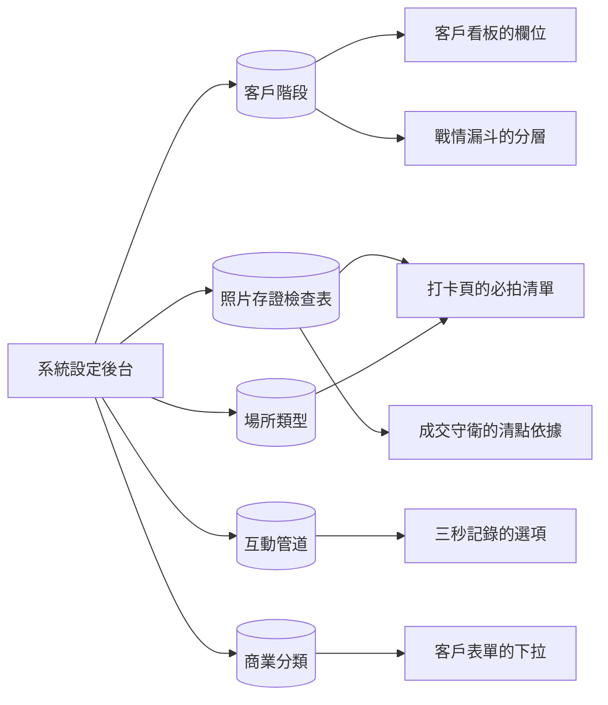

**純文字版:** 客戶階段、照片存證檢查表、互動管道、場所類型、商業分類這五張主檔存在資料庫裡,由後台維護。改了階段名稱,客戶看板的欄位標題與戰情漏斗的分層跟著變;改了照片存證檢查表,打卡頁的必拍清單與成交守衛的清點依據跟著變;改了互動管道,三秒記錄的選項跟著變。

---

## 功能總表

| 功能 | 誰能用 | 頁面 | 主要 API |
|---|---|---|---|
| 我的首頁,今日三件事與今日拜訪計畫 | 全部 | `/admin/crm/home` | `admin/crm` |
| 新增客戶 | 全部 | `/admin/crm/new` | `admin/crm` |
| 秒查客戶,名稱識別碼聯絡人電話邊打邊出 | 全部 | `/admin/crm/search` | `admin/crm` |
| 客戶看板,拖拉換階段 | 全部 | `/admin/crm/board` | `admin/crm` |
| 客戶卡與完整時間軸 | 全部 | `/admin/crm/<id>` | `admin/crm` |
| 本週工作報告與拜訪排程 | 全部 | `/admin/crm/week` | `admin/crm-visit-plans` |
| 主管戰情,開發量階段漏斗貢獻度 | 主管 管理員 | `/admin/crm/stats` | `admin/crm-stats` |
| 客戶查重合併 | 全部 | `/admin/crm/duplicates` | `admin/crm-duplicates` |
| 名單批次匯入 | 全部 | `/admin/crm/import` | `admin/crm` |
| 批次轉派 | 主管 管理員 | `/admin/crm/transfer` | `admin/crm` |
| 資料管理,匯出與回收桶 | 全部 | `/admin/crm/data` | `admin/crm-export`,`admin/crm-trash` |
| 拜訪地圖,依距離排序與路線規劃 | 全部 | `/admin/crm/map` | `admin/crm-map` |
| GPS 到訪打卡與拍照存證 | 全部 | `/admin/crm/field/checkin` | `admin/crm-checkin` |
| 拜訪日報 | 全部 | `/admin/crm/field/report` | `admin/crm-daily-reports` |
| 我聯絡過的客戶 | 全部 | `/admin/crm/field/contacts` | `admin/crm-contacts` |
| 日報彙整,主管讀取標記已讀寫批註 | 全部 | `/admin/crm/daily-reports` | `admin/crm-daily-reports` |
| 團隊成員與邀請連結 | 主管 管理員 | `/admin/team` | `admin/crm-invites`,`admin/departments` |
| 使用者管理 | 管理員 | `/admin/users` | `admin/users` |
| 系統設定 | 管理員 | `/admin/settings` | `admin/app-settings` |
| 單一登入設定 | 管理員 | `/admin/settings/sso` | `admin/sso` |
| 錯誤記錄 | 管理員 | `/admin/errors` | `admin/errors` |
| 首次啟動精靈 | 尚未安裝時 | `/setup` | `setup` |
| 接受邀請 | 持有連結的人 | `/invite/<token>` | `invites` |
| 外部查詢帶入 | 全部 | 客戶表單內 | `admin/lookup` |

## 角色與權限

| | 業務 sales | 業務主管 sales_manager | 系統管理者 admin |
|---|---|---|---|
| 看得到的客戶 | 自己名下 | 自己團隊加所屬部門子樹 | 全部 |
| 新增客戶、打卡、拍照、日報 | 可以 | 可以 | 可以 |
| 主管戰情 | 看不到 | 團隊範圍 | 全部 |
| 批次轉派 | 不能 | 團隊範圍內 | 全部 |
| 發邀請連結 | 不能 | 可以 | 可以 |
| 團隊成員 | 看不到 | 自己團隊 | 全部 |
| 使用者管理、系統設定、錯誤記錄 | 看不到 | 看不到 | 可以 |

部門是一棵樹,主管的可見範圍沿著自己所屬部門往下展開。

## 後台可以設定的項目

| 設定分頁 | 改了會影響 |
|---|---|
| 組織與品牌 | 系統名稱、浮水印中央那行字 |
| 時區與地區 | 日期怎麼算一天、數字與日期格式、地理編碼的 `Accept-Language` |
| 客戶階段 | 看板欄位、戰情漏斗、客戶表單下拉。可增刪、改名、改順序、標記終止階段 |
| 照片存證檢查表 | 打卡頁的必拍清單、成交守衛清點的依據。可依場所類型指定 |
| 互動管道 | 三秒記錄的選項、時間軸上的管道名稱 |
| 場所類型 | 客戶表單下拉、決定該拍哪幾張照片 |
| 商業分類 | 客戶表單下拉、匯入時的分類比對 |
| 地圖與地理編碼 | 圖磚服務網址、地理編碼服務、國碼限制、預設鏡頭位置與縮放 |
| 外觀 | 主題色、深淺色 |
| 外部查詢帶入 | 識別碼欄位的名稱、查詢服務網址、欄位對應 |
| 組織部門 | 部門樹,決定主管的可見範圍 |

---

## 螢幕截圖

畫面裡的公司、人名、地址、電話全部是示範資料。

**拍照存證與浮水印**

| | |
|---|---|
| 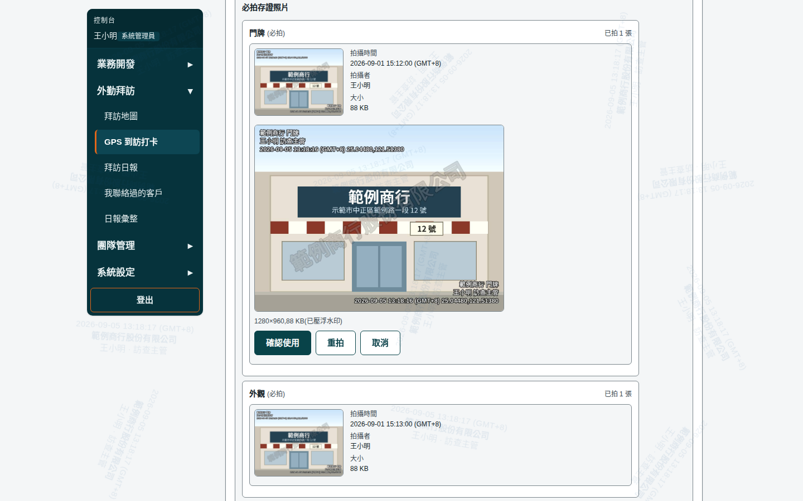 | 依客戶場所類型列出必拍的照片,缺件會擋住標記成交。按下快門後浮水印在裝置端就壓好,訪查人員確認才算數 |

現場拍的存證照片,左上與右下各一組浮水印,中央斜蓋組織名稱:

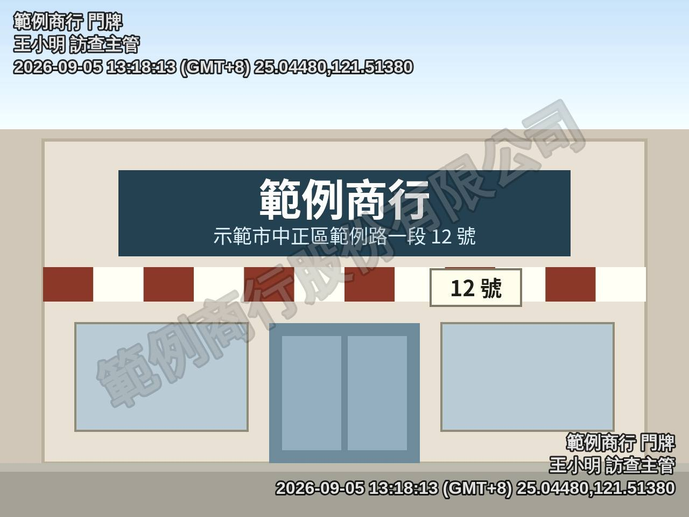

**桌機**

| 我的首頁 | 客戶看板 |
|---|---|
| 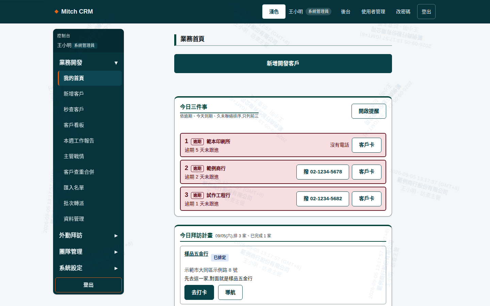 | 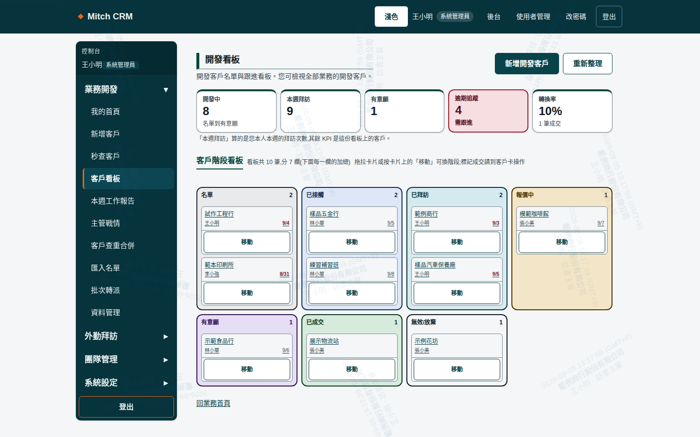 |

| 客戶卡 | 主管戰情 |
|---|---|
| 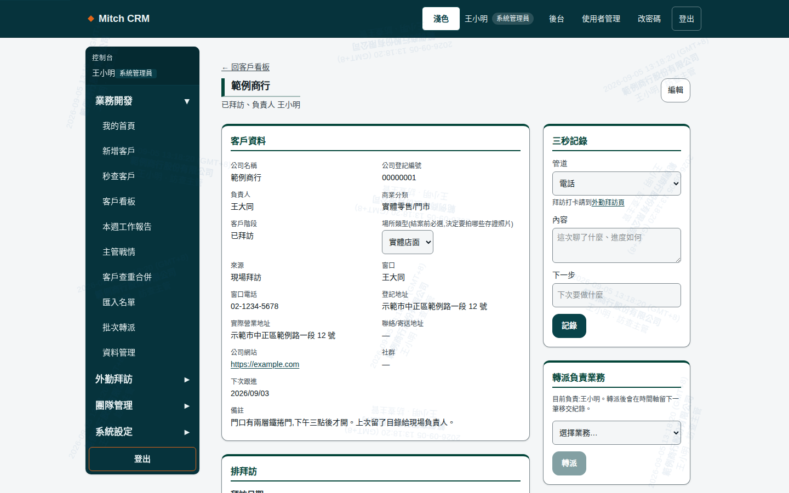 | 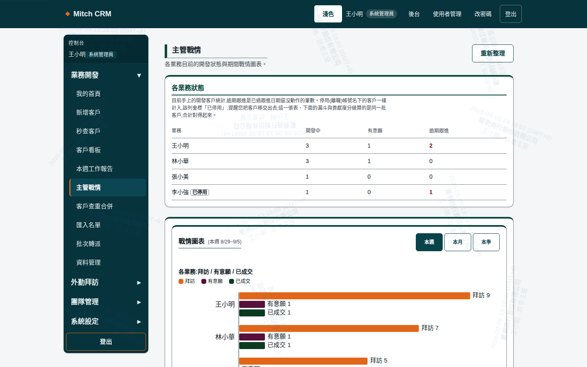 |

拜訪地圖:

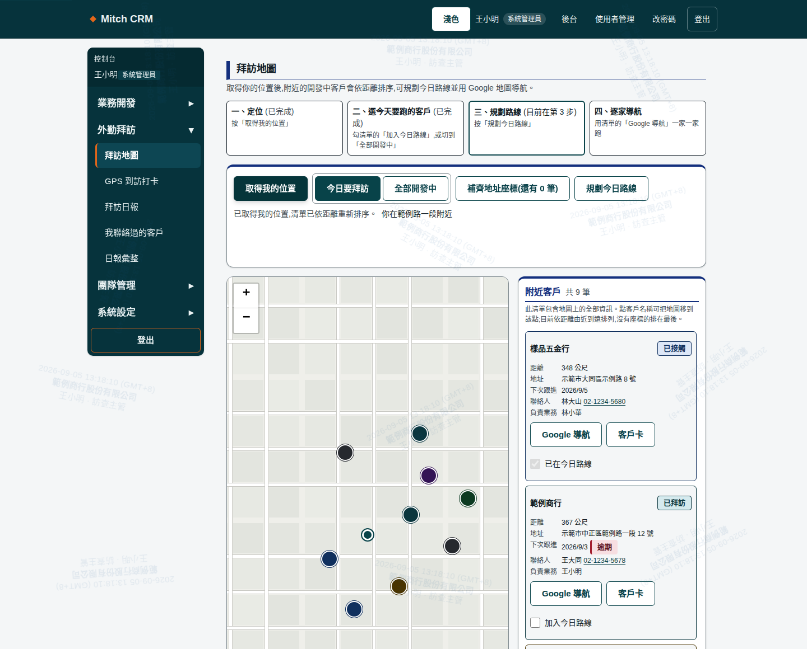

**手機**

外勤是主要場景,每一頁都先在手機上站得住。

| 我的首頁 | 拜訪地圖 | GPS 到訪打卡 | 客戶卡 |
|---|---|---|---|
| 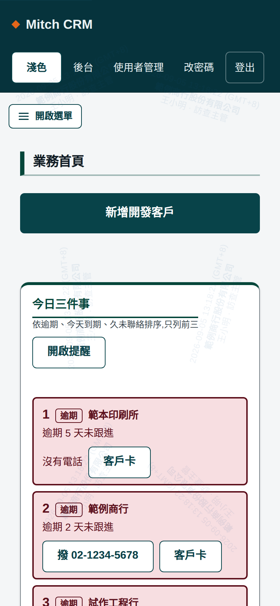 | 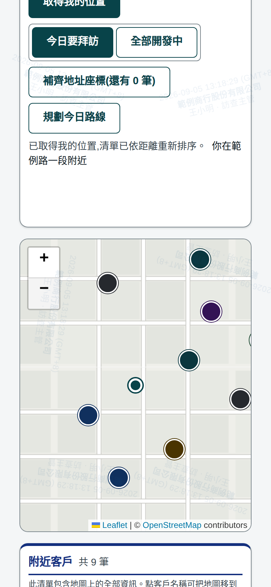 | 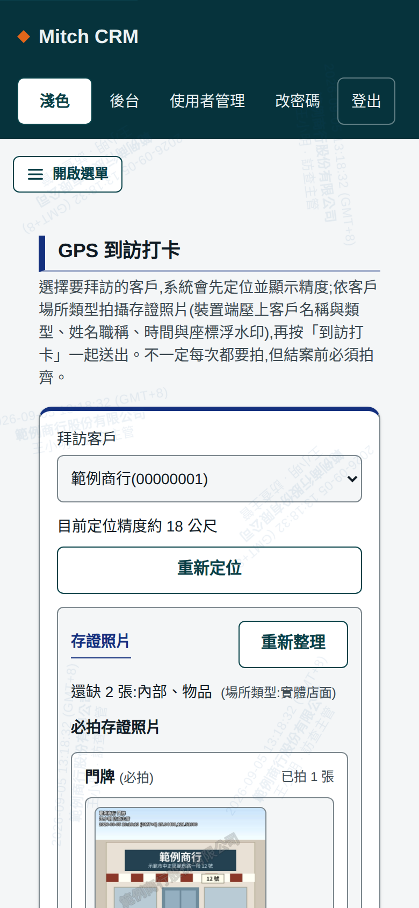 | 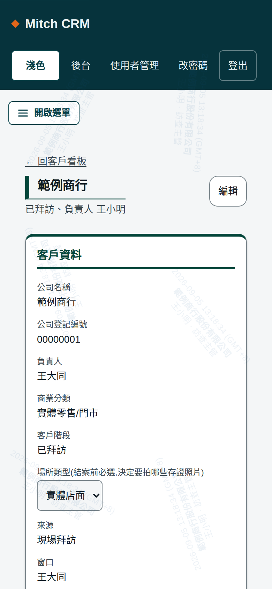 |

地圖底圖為示意方格,實際部署時的圖磚服務由後台設定,預設是 OpenStreetMap 的公共圖磚。

---

## 怎麼開始

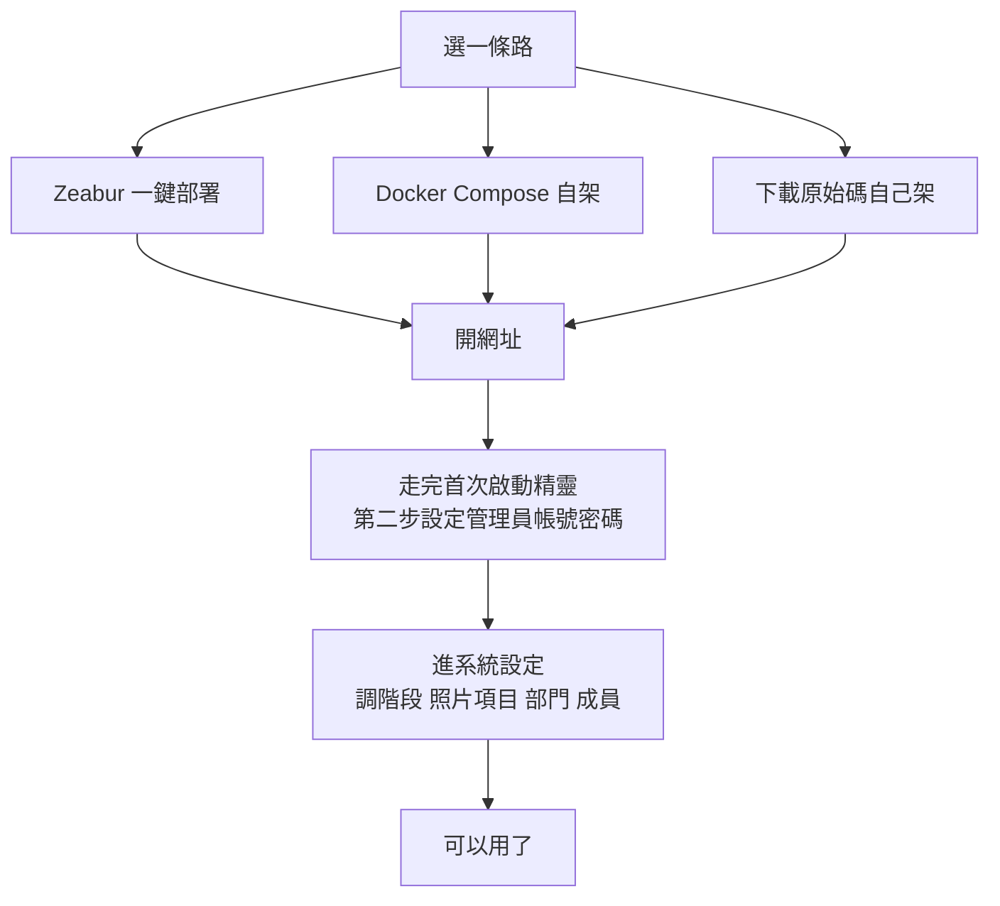

三條部署路徑殊途同歸。部署完成之後開網址,系統會帶你走一次首次啟動精靈,第二步就是設定自己的管理員帳號密碼。精靈走完進系統設定,把客戶階段、照片存證檢查表、組織部門、團隊成員調成自己的樣子,就可以開始用了。

### 路線一:Docker Compose 自架

需要 Docker 24 以上與 Docker Compose 2.24 以上。

```bash
git clone https://github.com/chenmitchell/mitch-crm-release.git
cd mitch-crm-release
bash scripts/setup.sh            # 產生 .env 與隨機金鑰
# 編輯 .env,至少確認 PUBLIC_BASE_URL 與 POSTGRES_PASSWORD
docker compose up -d --build
```

建置需要對外網路,而且不只是 npm registry。前端用 `next/font/google` 自架 Noto Sans TC,`next build` 會去打 `fonts.googleapis.com` 與 `fonts.gstatic.com`;Prisma 會去 `binaries.prisma.sh` 抓查詢引擎。只放行 registry 的環境要另外設定,做法見 [`.env.example`](.env.example) 與 [`docs/安裝與部署.md`](docs/安裝與部署.md)。

開瀏覽器進 `PUBLIC_BASE_URL`(預設 http://localhost:8080)走精靈。

> [!WARNING]
> **請立刻把精靈走完再去做別的事。** 精靈靠「資料庫裡還沒有任何使用者」把關,所以從服務起來到有人完成精靈為止,任何連得到這個網址的人都可以把管理員設成自己的。要避開這個空窗,就在 `.env` 填 `SEED_ADMIN_EMAIL` 與 `SEED_ADMIN_PASSWORD`,起站時管理員已經存在,精靈不會出現。詳見 [`SECURITY.md`](SECURITY.md)。

### 路線二:Zeabur 一鍵部署

1. 把這個 repo fork 到自己的 GitHub 帳號
2. 在 Zeabur 建一個專案,先加一個 PostgreSQL 服務
3. 加入服務,選自己 fork 的 repo,建立後端與前端兩個服務。repo 內已附 `zbpack.*.json`,平台會讀 Dockerfile 建置。**服務名稱要維持 `backend` 與 `frontend`**,`zbpack.*.json` 是照服務名稱對應的
   要用 [`zeabur/template.yaml`](zeabur/template.yaml) 一次匯入的話,**先把檔案裡兩處 `repoURL` 的 `YOUR-ACCOUNT` 換成自己的 GitHub 帳號**
4. 填環境變數。後端要填 `DATABASE_URL`(從 PostgreSQL 服務的連線資訊帶入)與 `CORS_ORIGIN`(前端的對外網址);前端要填 `NEXT_PUBLIC_API_BASE_URL`(後端的對外網址)與 `NEXT_PUBLIC_SITE_URL`(前端自己的網址)。`NEXT_PUBLIC_*` 是建置時編進 bundle 的,改了要重新建置
5. 前後端在 PaaS 上是兩個網域。兩個網域的可註冊網域不同時,瀏覽器會把登入視為跨站,`COOKIE_SAMESITE` 要設 `none` 並且 `COOKIE_SECURE=true`
6. 部署完成後開網址,走首次啟動精靈

> [!WARNING]
> 最後一步請在部署完成後**馬上**做。平台配發的網域一上線就是公開的,先走完精靈的人就是管理員。要避開這個空窗,在第 4 步一併填 `SEED_ADMIN_EMAIL` 與 `SEED_ADMIN_PASSWORD`。

其他平台(Render、Fly.io、自家 Kubernetes)同樣看得懂這兩個 Dockerfile。詳細說明見 [`docs/安裝與部署.md`](docs/安裝與部署.md)。

### 路線三:下載原始碼自己架

要 Node 20.11 以上、pnpm、一台 PostgreSQL 16。

```bash
pnpm install
cp apps/backend/.env.example apps/backend/.env      # 填 DATABASE_URL
cp apps/frontend/.env.example apps/frontend/.env
pnpm --filter @mitchcrm/backend exec prisma db push
pnpm dev
```

資料表由後端啟動時自己建,不需要手動跑 migration。

---

## 環境變數

完整清單在 [`.env.example`](.env.example) 與 [`docs/安裝與部署.md`](docs/安裝與部署.md),這裡列必須知道的。

用 `docker compose up -d` 的話,`.env` 一個字都不填也起得來,`docker-compose.yml` 給每一項都準備了 fallback。下表的「必填」講的是起不起得來。

| 變數 | 必填 | 預設 | 說明 |
|---|---|---|---|
| `PUBLIC_BASE_URL` | 否,但**幾乎一定要改** | `http://localhost:8080` | 使用者在瀏覽器打的網址。前端建置時會編進 bundle,改了要重新建置。compose 會用它自動帶出 `CORS_ORIGIN` |
| `CORS_ORIGIN` | 否 | 跟隨 `PUBLIC_BASE_URL` | 允許呼叫後端的來源網域,同時是 CSRF 的來源白名單,**必須等於使用者瀏覽器實際打的網址** |
| `DATABASE_URL` | 視情況 | 無 | 接外部資料庫時填整串連線字串。用 compose 內建資料庫時不必填 |
| `POSTGRES_DB` / `POSTGRES_USER` | 否 | `mitchcrm` | compose 內建資料庫的名稱與帳號 |
| `POSTGRES_PASSWORD` | 否,但**一定要改** | `mitchcrm` | 只用英數字,`openssl rand -hex 24`。**要在第一次 `docker compose up` 之前填好**,postgres 只在資料目錄還是空的時候拿它建帳號 |
| `JWT_ACCESS_SECRET` | 否 | 起站時自動產生 | 留空時由 entrypoint 產生並寫進 `app-secrets` volume,那份是唯一的副本。要自己指定就填至少 32 字元,`openssl rand -base64 48`,並且離線備份 |
| `SEED_ADMIN_EMAIL` | 否 | 無 | 自動建立管理員時用的信箱。走精靈的話留空即可 |
| `SEED_ADMIN_PASSWORD` | 否 | 無 | 留空表示由精靈當場設定管理員。填了就用它建帳號並要求首次登入改密碼,**至少 12 個字元** |
| `BACKEND_PORT` | 否 | `8787` | 後端監聽埠,不對外開放 |
| `SITE_ADDRESS` | 否 | `:80` | 反向代理監聽位址。填網域則自動申請 Let's Encrypt 憑證 |
| `APP_PORT` / `APP_HTTPS_PORT` | 否 | `8080` / `8443` | host 上要開的埠 |
| `COOKIE_SECURE` | 否 | `false` | 走 https 一定要設 true |
| `COOKIE_SAMESITE` | 否 | `lax` | 前後端在不同網域時要設 `none`,並一併把 `COOKIE_SECURE` 設 `true` |
| `TRUST_PROXY_HOPS` | 否 | `1` | 前面每多一層 LB 或 CDN 就加 1 |
| `JWT_ACCESS_TTL` | 否 | `8h` | 離開多久之後要重新登入。還在操作的話效期過半會自動重簽 |
| `LOGIN_MAX_ATTEMPTS` / `LOGIN_LOCKOUT_MINUTES` | 否 | `5` / `30` | 登入失敗幾次鎖多久 |
| `ERROR_LOG_RETENTION_DAYS` | 否 | `30` | 錯誤記錄保留天數 |
| `AUDIT_LOG_RETENTION_DAYS` | 否 | `730` | 稽核記錄保留天數。0 為永不刪除 |
| `NOMINATIM_EMAIL` | 否 | 無 | 地理編碼要帶的聯絡信箱 |

### 單一登入,選用

Microsoft Entra ID 的四個憑證值從環境變數給。後台的「單一登入設定」存的是政策(哪些網域可以登入、要不要自動建帳號、預設部門與主管)。

| 變數 | 說明 |
|---|---|
| `ENTRA_TENANT_ID` | 目錄(租用戶)識別碼 |
| `ENTRA_CLIENT_ID` | 應用程式(用戶端)識別碼 |
| `ENTRA_CLIENT_SECRET` | 用戶端密碼,建立後只顯示一次 |
| `ENTRA_REDIRECT_URI` | 要與 Entra 應用程式註冊裡的值一字不差,結尾不要多斜線 |
| `ENTRA_ALLOWED_DOMAINS` | 允許登入的信箱網域,逗號分隔。後台可覆蓋 |
| `ENTRA_AUTO_PROVISION` | 第一次 SSO 登入時要不要自動建帳號。後台可覆蓋 |
| `ENTRA_POST_LOGIN_URL` | 登入成功後導去哪裡 |

四個憑證沒有全部填齊時,登入頁不會出現 Microsoft 按鈕。

---

## 目錄結構

```
mitch-crm/
├── apps/
│   ├── frontend/              Next.js 15 App Router + Tailwind,:3000
│   │   ├── src/app/           31 條路由
│   │   ├── src/components/    元件
│   │   └── src/lib/           前端共用邏輯(離線佇列、設定、錯誤處理)
│   └── backend/               NestJS 10 + Prisma,:8787
│       ├── prisma/schema.prisma
│       └── src/
│           ├── crm/           客戶、打卡、照片、地圖、匯出、查重、刪除、排程、日報、戰情
│           ├── auth/          登入、Entra ID SSO
│           ├── scope/         可見範圍
│           ├── app-settings/  業務主檔與後台設定
│           └── setup/         首次啟動精靈
├── packages/shared/           共用型別、組織時區的日期計算、共用字彙
├── docs/                      安裝與部署、功能說明、設定說明
├── scripts/setup.sh           產生 .env 與隨機金鑰
├── deploy/                    Caddyfile 與後端 entrypoint
├── zeabur/template.yaml       Zeabur 一鍵部署範本
└── docker-compose.yml
```

---

## 常見問題

<details>
<summary><strong>浮水印是伺服器加的還是手機加的?</strong></summary>

手機加的。相機或選檔之後,瀏覽器就在 canvas 上把浮水印畫進畫素裡,訪查人員按下確認使用才送出。伺服器收到的位元組本身就已經帶著浮水印,不是收到原圖再蓋上去。

</details>

<details>
<summary><strong>必拍項目怎麼設定?</strong></summary>

在系統設定的「照片存證檢查表」。可以增刪項目、改名稱,並依場所類型指定該拍哪幾張。改完前台的必拍清單與成交守衛的清點依據會跟著變。

</details>

<details>
<summary><strong>資料存在哪裡?照片也存資料庫嗎?</strong></summary>

全部在你自己的 PostgreSQL 裡,照片也是。寫入量由四層上限擋著:每張 600 KB、每次上傳 3 MB、每位客戶 20 MB、每位使用者每日 100 MB。容量算式見 [`docs/安裝與部署.md`](docs/安裝與部署.md)。

</details>

<details>
<summary><strong>沒有訊號的時候可以用嗎?</strong></summary>

已經開著的打卡頁可以繼續打卡拍照,存進裝置的待送出佇列,回到有訊號的地方一鍵重送,照片保留原始拍攝時間。

</details>

<details>
<summary><strong>邀請連結怎麼給對方?</strong></summary>

連結產生後複製起來,用既有的管道給對方。連結是一次性的,30 分鐘失效。

</details>

<details>
<summary><strong>升級會不會弄壞既有資料?</strong></summary>

結構變更設計成純新增:加欄位、加表、加索引,不改既有欄位型別、不刪欄位。啟動遷移每一步都可以重複執行。升級前仍請先備份,步驟見 [`docs/安裝與部署.md`](docs/安裝與部署.md)。

</details>

---

## 文件

- [`docs/安裝與部署.md`](docs/安裝與部署.md):自架完整步驟、系統需求、備份還原、升級
- [`docs/功能說明.md`](docs/功能說明.md):每個模組在做什麼、角色與權限、資料流
- [`docs/設定說明.md`](docs/設定說明.md):首次啟動精靈與後台設定
- [`CONTRIBUTING.md`](CONTRIBUTING.md)、[`SECURITY.md`](SECURITY.md)、[`CHANGELOG.md`](CHANGELOG.md)

## 貢獻

歡迎 issue 與 pull request。動手前請先讀 [`CONTRIBUTING.md`](CONTRIBUTING.md),有兩件事要先知道:

1. **前台不出現寫死的業務用語清單。** 客戶階段、場所類型、照片項目、互動管道、商業分類一律從設定讀。
2. **原始碼檔頭的署名註解不可刪除或修改**,新增檔案也要照樣加一行。那是 `LICENSE` 保留的姓名表示權的具體標的。

行為準則見 [`CODE_OF_CONDUCT.md`](CODE_OF_CONDUCT.md)。安全性問題請不要開公開 issue,照 [`SECURITY.md`](SECURITY.md) 的方式回報。

## 授權

Mozilla Public License 2.0,附姓名表示權附加條款。

可以商用、可以自架、可以改。改到的檔案要以同一份授權釋出,但不會傳染到你自己其他的程式碼。作者依著作權法保留姓名表示權,原始碼與文件中的作者署名請予保留。

各 `package.json` 的 `license` 欄位填的是 SPDX 代碼 `MPL-2.0`,實際約束以 [`LICENSE`](LICENSE) 全文為準。

著作權人:Mitchell Chen(陳彥輔)。「米球」與其對應之圖樣為作者之標識,權利屬作者所有,不隨授權移轉。

相依套件的授權另見 [`THIRD-PARTY-NOTICES.md`](THIRD-PARTY-NOTICES.md)。
